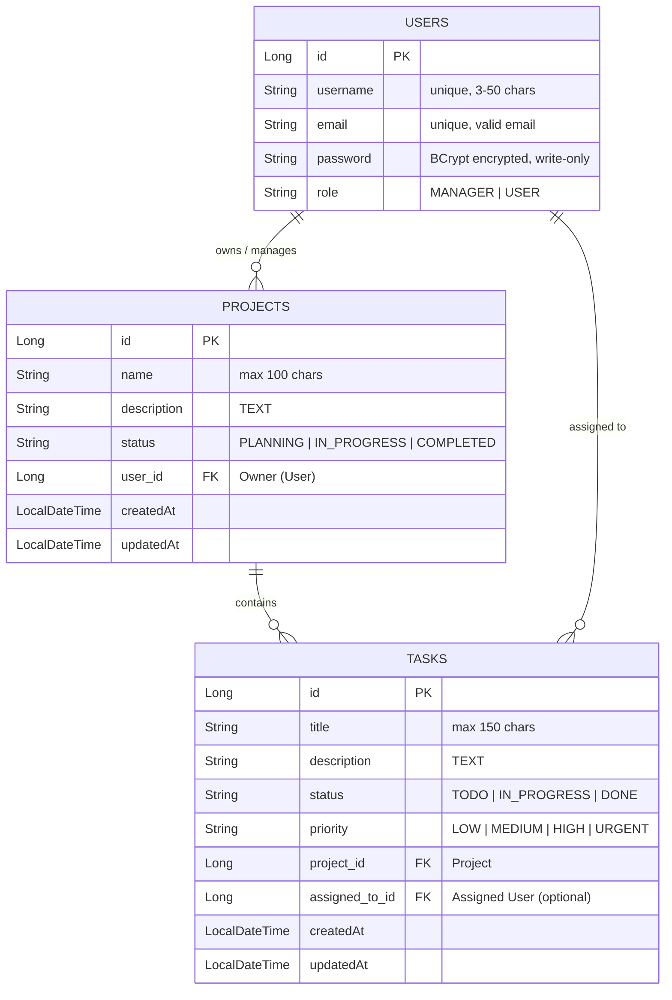

# 📋 Task Management SaaS REST API

> A robust, production-ready RESTful API for multi-role task management built with **Java 21**, **Spring Boot**, **Spring Security**, and **MySQL**.

**Technologies:** `Java 21` • `Spring Boot` • `Spring Security` • `JWT (JSON Web Tokens)` • `Spring Data JPA` • `Hibernate` • `MySQL` • `OpenAPI 3.0 (Swagger UI)` • `Maven` • `Lombok`

---

## 🚀 Key Features

- **🔐 Stateless JWT Authentication & Authorization**:
  - Secure token creation and claims extraction using JJWT (HMAC-SHA256).
  - Externalized persistent 256-bit secret key with zero token loss across server reboots.
  - Custom `OncePerRequestFilter` integration into the Spring Security filter chain.
  - Passwords hashed using `BCryptPasswordEncoder` (work factor 12).
- **👥 Role-Based Access Control (RBAC)**:
  - **`MANAGER`**: Create, edit, and delete projects; create and assign tasks; full management of owned resources.
  - **`USER` (Developer)**: View assigned projects and tasks; update task progress (`TODO` ➔ `IN_PROGRESS` ➔ `DONE`).
  - Resource ownership checks prevent cross-tenant/cross-user manipulation.
- **🛡️ Data Integrity & Defense-in-Depth**:
  - Input validation using Jakarta Validation (`@NotBlank`, `@Email`, `@Size`, `@Valid`).
  - Write-only serialization for passwords (`@JsonProperty(access = WRITE_ONLY)`) preventing hash leakage in JSON responses.
  - Protection against privilege escalation during user updates.
- **📖 Interactive API Documentation**:
  - Auto-generated OpenAPI 3.0 specifications and interactive **Swagger UI** for browser-based testing.
- **🗄️ Relational Data Modeling**:
  - Unidirectional & bidirectional JPA mappings (`@ManyToOne`) with lazy-loading performance optimization.
  - Automatic timestamp auditing (`@CreationTimestamp`, `@UpdateTimestamp`).
- **⚙️ Configuration Management**:
  - Database and security credentials decoupled into external `.env` configuration.

---

## 🏗️ Architecture & Database Design



---

## 🛠️ Tech Stack

| Component | Technology |
| :--- | :--- |
| **Language** | Java 21 (LTS) |
| **Framework** | Spring Boot |
| **Security** | Spring Security, JJWT, BCrypt |
| **API Documentation** | OpenAPI 3.0, Swagger UI (`springdoc-openapi`) |
| **ORM / Persistence** | Spring Data JPA, Hibernate, MySQL Connector/J |
| **Validation** | Jakarta Bean Validation (Hibernate Validator) |
| **Boilerplate Reduction** | Project Lombok |
| **Build Tool** | Apache Maven |
| **Database** | MySQL |

---

## 📖 Interactive API Documentation (Swagger UI)

The API is fully documented using **OpenAPI 3.0**. Once the application is running, you can explore, test, and execute all endpoints interactively in your browser without needing external tools like Postman:

- **Swagger UI Dashboard:** [http://localhost:8080/swagger-ui.html](http://localhost:8080/swagger-ui.html)
- **OpenAPI JSON Specification:** [http://localhost:8080/v3/api-docs](http://localhost:8080/v3/api-docs)

> 💡 **Quick Test via Swagger:**
> 1. Execute `POST /api/auth/register` and `POST /api/auth/login` to obtain your JWT token.
> 2. Copy the token and supply it in authorization headers to test protected Project and Task endpoints directly.

---

## 📡 API Reference

Base URL: `http://localhost:8080`

### 1. Authentication (`/api/auth`)
| Method | Endpoint | Access | Description |
| :--- | :--- | :--- | :--- |
| `POST` | `/api/auth/register` | Public | Register a new user (`MANAGER` or `USER`) |
| `POST` | `/api/auth/login` | Public | Authenticate with credentials and receive a JWT token |

### 2. User Management (`/api/users`)
| Method | Endpoint | Access | Description |
| :--- | :--- | :--- | :--- |
| `GET` | `/api/users` | Authenticated | List all registered users (passwords omitted) |
| `GET` | `/api/users/{id}` | Authenticated | Get user details by ID |
| `PUT` | `/api/users/{id}` | Authenticated (Self) | Update username, email, or password |
| `DELETE` | `/api/users/{id}` | Authenticated (Self) | Delete own user account |

### 3. Project Management (`/api/projects`)
| Method | Endpoint | Access | Description |
| :--- | :--- | :--- | :--- |
| `GET` | `/api/projects` | Authenticated | Retrieve all projects |
| `GET` | `/api/projects/{id}` | Authenticated | Retrieve a specific project by ID |
| `GET` | `/api/projects/user/{userId}` | Authenticated | Retrieve all projects owned by a specific user |
| `POST` | `/api/projects` | `ROLE_MANAGER` | Create a new project |
| `PUT` | `/api/projects/{id}` | `ROLE_MANAGER` (Owner) | Update an owned project's details |
| `DELETE` | `/api/projects/{id}` | `ROLE_MANAGER` (Owner) | Delete an owned project and its tasks |

### 4. Task Management (`/api/tasks`)
| Method | Endpoint | Access | Description |
| :--- | :--- | :--- | :--- |
| `GET` | `/api/tasks` | Authenticated | List all tasks |
| `GET` | `/api/tasks/{id}` | Authenticated | Retrieve task details by ID |
| `GET` | `/api/tasks/project/{projectId}` | Authenticated | Retrieve all tasks associated with a project |
| `POST` | `/api/tasks` | `ROLE_MANAGER` (Owner) | Create a task within an owned project |
| `PUT` | `/api/tasks/{id}` | Manager (Owner) / Dev | Manager: edit all fields; Developer: update status |
| `DELETE` | `/api/tasks/{id}` | `ROLE_MANAGER` (Owner) | Delete a task |

---

## 🚦 Getting Started

### Prerequisites
- **JDK 21** or later installed
- **Maven 3.8+** (or use the included `./mvnw` wrapper)
- **MySQL** server running

### 1. Clone the Repository
```bash
git clone https://github.com/<your-username>/task-management-saas-api.git
cd task-management-saas-api
```

### 2. Configure Environment Variables
Create a `.env` file in the project root directory (next to `pom.xml`):

```properties
DB_URL=jdbc:mysql://localhost:3306/task_management_db?useSSL=false&serverTimezone=UTC&allowPublicKeyRetrieval=true
DB_USERNAME=your_db_username
DB_PASSWORD=your_db_password
JWT_SECRET=your secret key
```

### 3. Create the Database
```sql
CREATE DATABASE task_management_db;
```

### 4. Build and Run
Using the Maven wrapper:

```bash
# On Linux / macOS / WSL:
./mvnw clean spring-boot:run

# On Windows:
.\mvnw.cmd clean spring-boot:run
```

The application will start on **`http://localhost:8080`**.  
Access the interactive Swagger documentation at **`http://localhost:8080/swagger-ui.html`**.

---

## 🧪 Testing with cURL / Postman

### 1. Register a Manager
```bash
curl -X POST http://localhost:8080/api/auth/register \
  -H "Content-Type: application/json" \
  -d '{
    "username": "alice",
    "email": "alice@example.com",
    "password": "securePassword123",
    "role": "MANAGER"
  }'
```

### 2. Authenticate & Obtain JWT
```bash
curl -X POST http://localhost:8080/api/auth/login \
  -H "Content-Type: application/json" \
  -d '{
    "email": "alice@example.com",
    "password": "securePassword123"
  }'
```
*Response:* Returns token string (e.g. `eyJhbGciOiJIUzI1NiJ9...`).

### 3. Create a Project (Using Bearer Token)
```bash
curl -X POST http://localhost:8080/api/projects \
  -H "Content-Type: application/json" \
  -H "Authorization: Bearer <YOUR_JWT_TOKEN>" \
  -d '{
    "name": "Cloud Migration",
    "description": "Migrate core infrastructure to AWS",
    "status": "PLANNING",
    "owner": { "id": 1 }
  }'
```

---

## 📁 Project Structure

```
task-management-saas-api/
├── src/
│   ├── main/
│   │   ├── java/com/shadow/taskmanagementsaasapi/
│   │   │   ├── controllers/      # REST API Controllers (Auth, User, Project, Task)
│   │   │   ├── model/            # JPA Entities (User, Project, Task)
│   │   │   ├── repository/       # Spring Data JPA Repositories
│   │   │   ├── security/         # SecurityConfig, JWTFilter, JWTService, UserPrincipal
│   │   │   └── service/          # Business Logic Services
│   │   └── resources/
│   │       └── application.properties # Main Spring configuration
│   └── test/                     # Unit and Integration Tests
├── screenshots/                  # Documentation & UI screenshots
├── .env                          # Local secrets (git-ignored)
├── pom.xml                       # Maven dependencies and build plugins
└── README.md
```

---

## 🔮 Upcoming Enhancements

- [ ] Centralized Exception Handling via `@RestControllerAdvice`
- [x] Interactive Swagger / OpenAPI documentation via `springdoc-openapi`
- [ ] Containerized deployment with Docker and Docker Compose
- [ ] Query pagination and sorting (`Pageable`) for project and task listings

---

## 📄 License

This project is licensed under the [MIT License](LICENSE).
